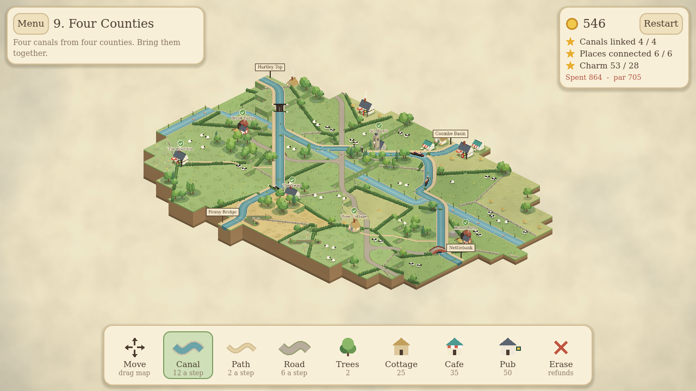

# Cozy Canals

A cosy canal-building game set in the British countryside, for phones and tablets.
Restore silted-up cuts and dig new ones, then give every village, pub and farm
a way to reach the water.



## Running it

1. Install [Godot 4.5](https://godotengine.org/download) (standard build, not .NET).
2. Open the editor, choose **Import**, and pick `project.godot` from this folder.
3. Press **F5** to play.

To play on a phone or tablet, use Godot's **one-click deploy** (Android) or
**Project > Export** (Android / iOS) once the export templates are installed.

## How to play

Canals run off the edge of the map at signposted points. Drag with the Canal
tool to draw a line between them, in any direction; it is drawn as a smooth
curve. Once two are joined, narrowboats pass through and each one earns coins.

| Tool | What it does | Cost |
| --- | --- | --- |
| Move | Drag the map (two fingers pan and pinch-zoom with any tool) | - |
| Canal | Drag to dig. Cheap along derelict canal or a river. Climbing a level builds a lock | 12 a step, lock +25 |
| Path | Drag a footpath from a place to the towpath | 2 a step |
| Road | Drag a road from a farm to an existing road (later levels) | 6 a step |
| Trees, Cottage, Cafe, Pub | Add charm. Buildings go beside a canal, path or road | 2 - 50 |
| Erase | Removes what you built on a spot and refunds it in full | - |

A path or road that crosses water gets a bridge automatically (+20).

**Stars:** link every canal; connect every place (the badge over it shows
whether it wants a path or a road); reach the charm goal.
The Daily Cut also gives a score: stars first, then coins left and charm.

## Modes

- **Journey** - ten maps of rising difficulty: hills and locks, rivers, junctions, then roads and farms.
- **Daily Cut** - one map a day from the date, the same for everyone, with a score to beat.
- **Free Build** - a large map with no budget and no goals.

Every map comes from a seeded generator (`scripts/mapgen.gd`), so a level is
just a name, a seed and a few settings in `scripts/levels.gd`.

## Project layout

- `scripts/world.gd` - game state and rules (no rendering, so it is testable)
- `scripts/mapgen.gd` - map generator; `scripts/autobuild.gd` - solver used for budgets and tests
- `scripts/world_view.gd` - isometric renderer; `scripts/art.gd` - all artwork, drawn in code
- `scripts/main.gd` - menu, modes, input, camera and HUD
- `shaders/paper.gdshader` - paper grain and cloud-shadow overlay

## Tests

```bash
godot --headless --import
godot --headless -s tests/test_levels.gd      # every map generates, is solvable in budget, and refunds fully
xvfb-run godot -s tests/test_input.gd         # menu, finger-drag drawing, erase, boats, saving
```
