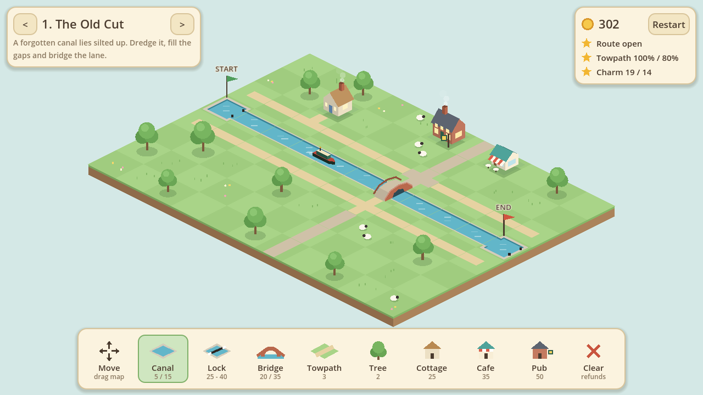

# Cozy Canals

A cosy canal-building game set in the British countryside, for phones and tablets.
Restore silted-up cuts, turn wild brooks into navigable canals and dig brand new
routes, then line them with towpaths, locks, bridges, pubs and cafes.



## Running it

1. Install [Godot 4.5](https://godotengine.org/download) (standard build, not .NET).
2. Open the editor, choose **Import**, and pick `project.godot` from this folder.
3. Press **F5** to play.

To play on a phone or tablet, use Godot's **one-click deploy** (Android) or
**Project > Export** (Android / iOS) once the export templates are installed.

## How to play

Join the **START** wharf to the **END** wharf with navigable water. Once the route
is open a narrowboat starts running and earns coins on every arrival.

| Tool | What it does | Cost |
| --- | --- | --- |
| Move | Drag the map (two fingers pan and pinch-zoom with any tool) | - |
| Canal | Dredge a river or derelict canal, or dig through grass. Drag to draw | 5 / 15 |
| Lock | Joins canal on two different levels | 25 - 40 |
| Bridge | Carries a lane or footpath over the canal | 20 / 35 |
| Towpath | Drag to lay a path beside the water | 3 |
| Tree, Cottage, Cafe, Pub | Add charm. Buildings go beside water, a towpath or a lane | 2 - 50 |
| Clear | Removes something you built and refunds it in full | - |

Each level has three stars: open the route, put a towpath beside 80% of it, and
reach the charm goal.

On desktop: left mouse builds, right mouse drags the map, the wheel zooms.

## Project layout

- `scripts/board.gd` - game state and rules (no rendering, so it is testable)
- `scripts/board_view.gd` - isometric renderer; all art is drawn in code
- `scripts/main.gd` - input, camera and HUD
- `scripts/levels.gd` - level maps as text grids; add a level by adding an entry
- `tests/` - headless checks

## Tests

```bash
godot --headless --import
godot --headless -s tests/test_levels.gd      # every level is solvable within budget
xvfb-run godot -s tests/test_input.gd         # taps and drags through the real scene
```
