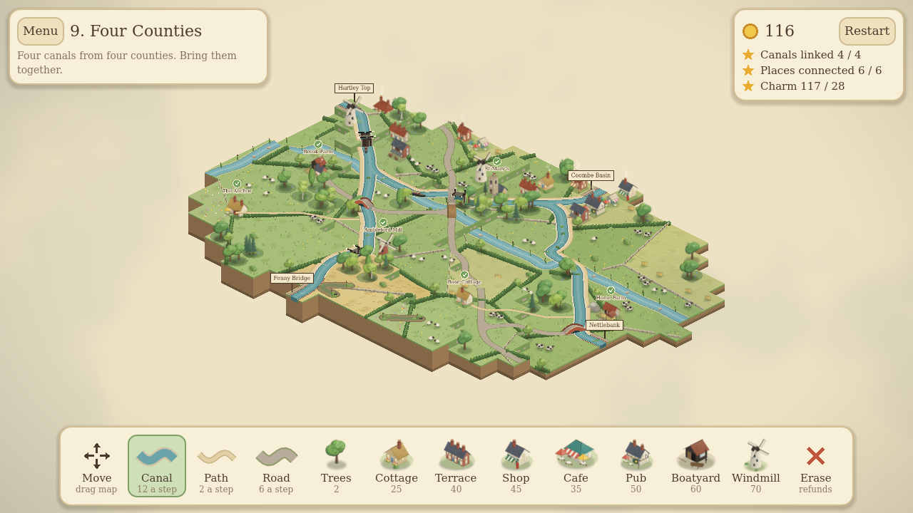

# Cozy Canals

A cosy canal-building game set in the British countryside, for phones and tablets.
Restore silted-up cuts and dig new ones, then give every village, pub and farm
a way to reach the water.



## Running it

1. Install [Godot 4.5](https://godotengine.org/download) (standard build, not .NET).
2. Open the editor, choose **Import**, and pick `project.godot` from this folder.
3. Press **F5** to play.

To play on a phone or tablet, use Godot's **one-click deploy** (Android) or
**Project > Export** (Android / iOS) once the export templates are installed.

## How to play

Canals run off the edge of the map at signposted points and on into the
countryside beyond. Drag with the Canal tool to draw a line between them; the
line follows your finger. Only the land inside the white outline can be built on. Once two are joined, narrowboats pass through and each one earns coins.

The build bar works like a city builder's: tap a category to open its tools,
tap a tool to pick it, and tap it again (or close the category) to put it down.
With no tool picked, one finger moves the map. Two fingers pan and pinch-zoom
at any time; the + / - / Fit buttons on the right zoom and bring the map back.

| Category | Tools | Cost |
| --- | --- | --- |
| Restore | Tap or drag along silted old canal to restore that part of it | 4 a length |
| Waterways | Canal (drag to dig; climbing a level builds a lock), Stone lock, Brick lock (tap a lock to rebuild it) | 12 a step, lock +25, rebuild 10 |
| Roads & Paths | Path, Road, and Brick, Stone or Footbridge (tap a bridge to rebuild it) | 2 / 6 a step, rebuild 10 |
| Buildings | Cottage, Terrace, Shop, Cafe, Pub, Boatyard, Windmill | 25 - 70 |
| Nature | Trees | 2 |
| Bulldoze | Remove anything you built, with a full refund | - |

A path or road that crosses water gets a bridge automatically (+20).

Restored canal keeps its Victorian look (brick edging, cinder towpath); newly
dug cut has pale stone coping and a fresh gravel towpath.

**Stars:** link every canal; connect every place (the badge over it shows
whether it wants a path or a road); reach the charm goal.
The Daily Cut also gives a score: stars first, then coins left and charm.

## Modes

- **Journey** - ten maps of rising difficulty: hills and locks, rivers, junctions, then roads and farms.
- **Daily Cut** - one map a day from the date, the same for everyone, with a score to beat.
- **Free Build** - a large map with no budget and no goals.

Every map comes from a seeded generator (`scripts/mapgen.gd`), so a level is
just a name, a seed and a few settings in `scripts/levels.gd`.

## Artwork

Standing objects (buildings, trees, animals, boats) are PNG sprites in
`assets/sprites`, with several variants of most buildings. The current set is
designed and rendered by `tools/make_sprites.js`; see `docs/sprites.png` for
the whole set. To use your own art, replace a PNG with one of the same name
(details in `assets/sprites/README.md`).

The ground, water, paths, hedges, bridges and locks are drawn in code, because
they follow whatever the player draws.

## Project layout

- `scripts/world.gd` - game state and rules (no rendering, so it is testable)
- `scripts/mapgen.gd` - map generator; `scripts/autobuild.gd` - solver used for budgets and tests
- `scripts/world_view.gd` - isometric renderer; `scripts/sprites.gd` - sprite loader; `scripts/art.gd` - code-drawn ground and canal structures
- `scripts/main.gd` - menu, modes, input, camera and HUD
- `shaders/paper.gdshader` - paper grain and cloud-shadow overlay

## Tests

```bash
godot --headless --import
godot --headless -s tests/test_levels.gd      # every map generates, is solvable in budget, and refunds fully
xvfb-run godot -s tests/test_input.gd         # menu, finger-drag drawing, erase, boats, saving
```
